<!-- Profile README · variant A "Consola". The banner lives in this repo: assets/banner.svg -->

  

First-year **ASIR** student (Network & Systems Administration) with a data-engineering background: SQL, Python, ETL and Power BI. I build the infrastructure and the pipelines that move data where it needs to go.

**→ The story behind each project is on my portfolio: [zhgx-alt.github.io](https://zhgx-alt.github.io)**

### Featured

| Project | What it is |
|---|---|
| **[Almi-Chain](https://zhgx-alt.github.io/projects/almi-chain/)** · [code](https://github.com/zHGx-alt/Almi-Chain) | The complete IT setup for a restaurant chain, built by a team of six in four weeks. I coordinated the team. |
| **[E-commerce Analytics](https://zhgx-alt.github.io/projects/ecommerce-analytics/)** · [code](https://github.com/zHGx-alt/ecommerce-analytics) | Where does an online store lose its customers? From raw click events to a Power BI dashboard. |

# 💻 Tech Stack:

**Systems & networks** 
    

**Data** 
       

**Tools** 
   

[Portfolio](https://zhgx-alt.github.io) · [LinkedIn](https://www.linkedin.com/in/adrian-paneda-de-la-figuera) · [CV](https://zhgx-alt.github.io/assets/cv.pdf)
